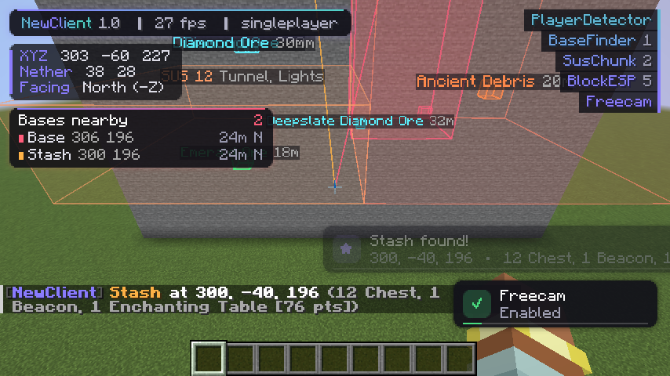

# NewClient

A **strictly client-side** utility client for **Fabric 1.21.11**, made for finding ores and locating bases on anarchy servers like 2b2t.

> **Zero server interaction.** NewClient never sends a packet, never registers a network channel and never interacts with the server.
> It only reads what the server already sends to every client (chunks, entities, tab list) and draws on your screen.
> Anything that would need to talk to the server is not included.



## Modules

| Module | Category | What it does |
|---|---|---|
| **BlockESP** | Render | Highlights chosen blocks (diamonds, debris, emeralds, spawners...) through walls. Per-block colors, box/outline/fill styles, tracers, labels, range fade. Pick blocks from a searchable grid with item icons and presets (Ores / Valuables / Storage). |
| **Freecam** | Render | Moves only the camera. Your player stays still and keeps sending exactly the same packets as an AFK player. Attack/use/pick-block are blocked while it is on, so nothing can be sent from the camera's view. Smooth cinematic flight, sprint boost, outline of your real position, auto-disables if you take damage. |
| **BaseFinder** | World | Scores every loaded chunk for player-made blocks and entities (shulkers, ender chests, beacons, signs, redstone, concrete, item frames, armor stands, chest boats...) and detects **stashes** (many storage blocks in a chunk). Natural structures such as villages, dungeons, bastions, fortresses, ancient cities, end cities, trial chambers, strongholds, temples and ruined portals are filtered out. Toast, chat line and sound on finds. Finds are saved per server and shown as waypoint beams, even after the chunk unloads. |
| **SusChunk** | World | Flags chunks with **hidden** activity: straight dug tunnels (flat floor + ceiling), buried storage, torches/lanterns underground, lit portals, rails or overworld blocks in the Nether, grown farms. Heat-colored chunk boxes with reasons. Ignores the main highways (configurable). Optional **chunk age overlay** (old vs. new generation) for following travel trails. |
| **PlayerDetector** | Misc | Alerts when a player enters or leaves your visual range (toast, chat, sound, cooldown). Friends list (no alerts, green). Box, tracers, nametags (health + distance), a radar HUD with each player's held item and health bar, **logout spots**, optional tab-list join/leave alerts, and an encounter log. |

## Interface

* **ClickGUI**: press **Right Shift**. Draggable, collapsible panels with animated toggles, sliders, an HSV color picker, keybinds, a module search (just start typing) and a description bar.
  * Left click: toggle. Right click: settings. Middle click: bind a key.
* **Saved Finds** (★ button in the GUI): every base, stash and sus chunk found on the current server. You can copy coords, delete entries and filter by type.
* **HUD**: watermark, animated module list, coords plus converted Nether/Overworld coords, a "Bases nearby" list, the player radar and toast notifications.
* **Client panel**: accent colors (or chroma), panel opacity, blur, HUD toggles, which side the module list is on, and a *Hide Coords* streamer mode.

Everything is saved automatically to `.minecraft/config/newclient/`:
* `config.json`: modules, settings, keybinds and GUI layout
* `finds/<server>.json`: saved waypoints
* `finds/<server>.log`: human-readable log of every find, encounter and logout

| ClickGUI | Block picker | Saved finds |
|---|---|---|
|  |  |  |

*(Screenshots from the automated in-game test, small window with software rendering.)*

## Install

1. Install **Fabric Loader** (0.17+) for Minecraft **1.21.11**.
2. Put **Fabric API** for 1.21.11 and `newclient-1.0.0.jar` in `.minecraft/mods`.
3. Launch, join a world, press **Right Shift**.

## Build

```
./gradlew build          # -> build/libs/newclient-1.0.0.jar
./gradlew runClient      # dev client
./gradlew runClientGameTest   # headless in-game smoke test with screenshots
```

Requires JDK 21.

## Notes on anticheat safety

* No module sends packets, changes movement, rotation, interaction or inventory, or registers network channels.
* Freecam leaves the real player as the camera entity, so vanilla keeps sending its normal idle position updates. Only the render camera moves.
* Chat messages from the client are local (they only appear in your own chat). Sounds are local UI sounds.
* Chunk scanning is spread over ticks (4 ms budget) so it never freezes the game.
* Fabric API itself announces the usual Fabric channels to the server like any Fabric client; NewClient adds nothing to that.
