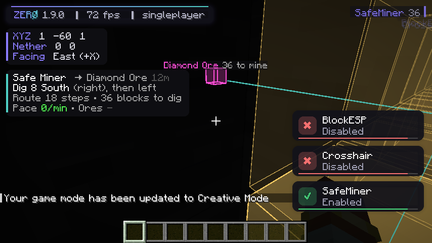
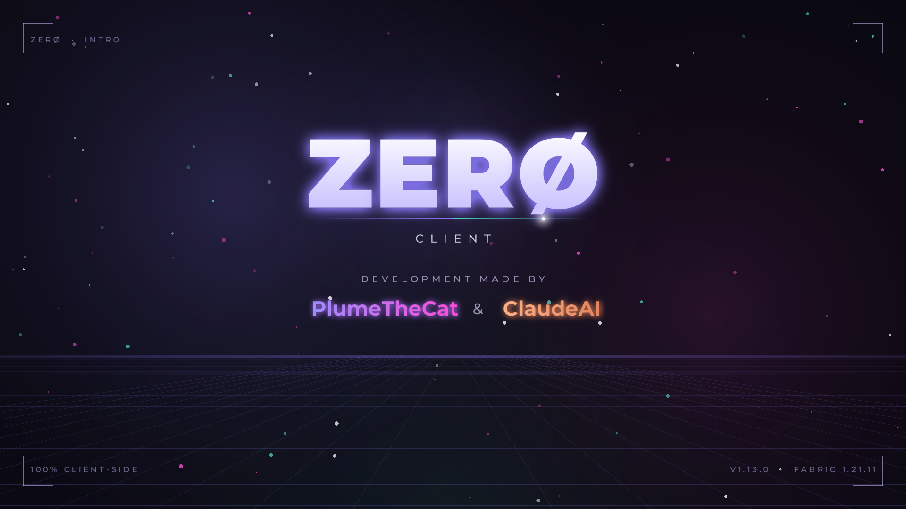
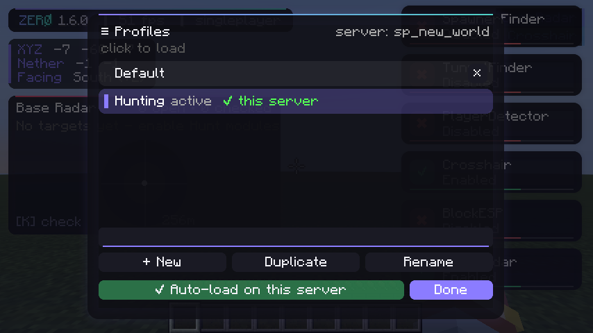
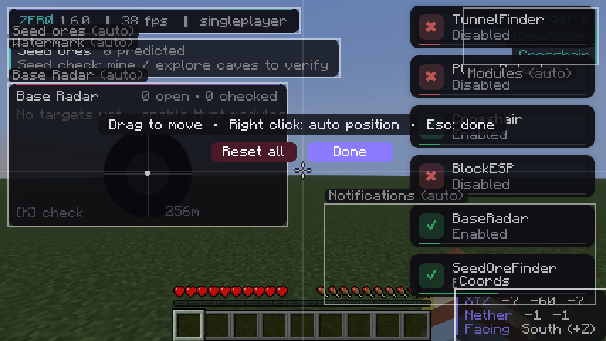
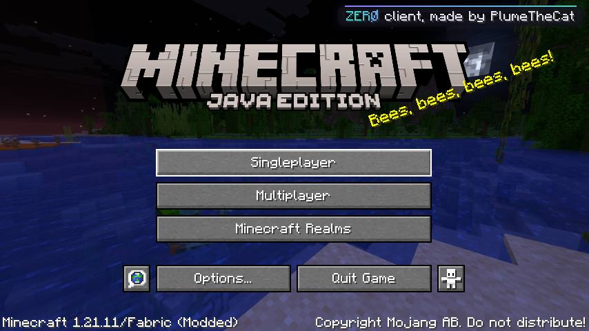
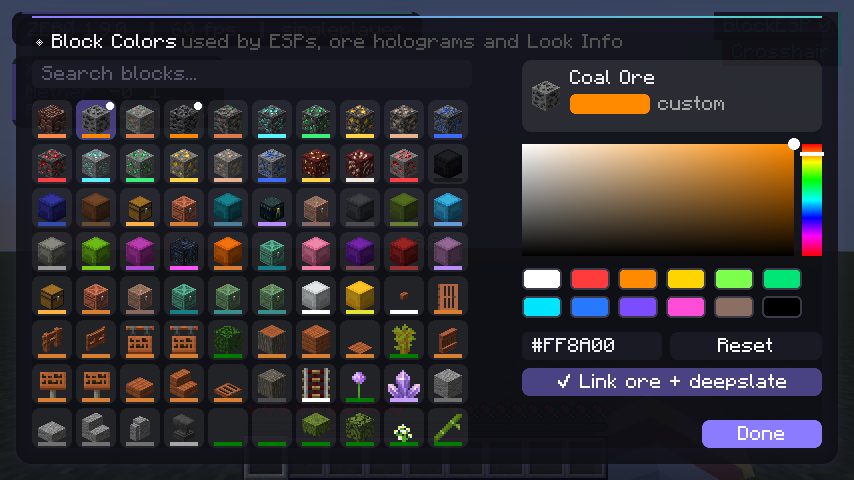

# ZERØ

A **strictly client-side** utility client for **Fabric 1.21.11**, made for finding ores and locating bases on anarchy servers like 2b2t.

> **Zero server interaction.** ZERØ never sends a packet, never registers a network channel and never interacts with the server.
> It only reads what the server already sends to every client (chunks, entities, tab list) and draws on your screen.

## Download

**[⬇ Latest ZERØ jar](https://github.com/PlumedeParis/NewClient/releases/latest)**: built automatically by GitHub Actions on every push.

Install: **Fabric Loader** (0.17+) and **Fabric API** for **1.21.11**, put the `zero-x.y.z.jar` in `.minecraft/mods`, then press **Right Shift** in game.


## Modules

| Module | Category | What it does |
|---|---|---|
| **BlockESP** | Render | Highlights chosen blocks through walls: per-block colors, box/outline/fill, tracers, labels. Searchable block picker with presets. **Exposed Only** mode ignores anti-xray fake ores. |
| **StorageESP** | Render | Chests (double chests merged), trapped chests, ender chests, shulkers in their dye color, barrels, hoppers, furnaces, dispensers, brewing stands, chest minecarts / chest boats. Per-type colors, tracers and per-chunk "N storage" counts. |
| **Fullbright** | Render | See in the dark: raises your local lightmap like night vision (Strength setting). No potion effect, nothing sent. |
| **XRay** | Render | Hides everything except your chosen blocks, with fullbright. Works with Fabric API's renderer. See the anti-xray note below. |
| **SpawnerESP** | Render | Every mob spawner and trial spawner through walls, colored by mob type (zombie, skeleton, blaze, pig...), with labels, tracers and an optional 16-block activation-range box. |
| **Crosshair** | Render | Custom pixel crosshair with an editor: paint on a 15x15 grid (left paint / right erase), mirror X/Y, 7 presets, color swatches, outline, scale, target color and attack-cooldown bar. Live preview on light and dark backgrounds. |
| **Freecam** | Render | Moves only the camera. Your player stays still and sends exactly what an idle player sends. Attack, use and pick-block are blocked while it is on. |
| **PlayerDetector** | Misc | Visual-range alerts, friends, radar HUD, ESP and nametags, logout spots, join/leave alerts, encounter log. |


### World

| Module | What it does |
|---|---|
| **SeedOreFinder** | Type the world seed and ZERØ predicts ores (diamonds, debris, emeralds, gold, iron, redstone, lapis, copper, coal, quartz). It runs Minecraft 1.21.11's **own ore generation code** locally, from the seed, against a private copy of the terrain you have loaded. Predictions are shown as **holograms** (a see-through copy of the real ore block, visible through walls) everywhere in the radius, **including chunks you have not loaded or cannot see**. An **Ore Type** option shows normal ores, deepslate ores or both. A live **seed match %** compares predictions with ores you can actually see, so you know immediately whether the seed works on that server. |
| **SafeMiner** | Draws a mining route to the ores you choose, shaped to look like normal mining: straight 1x2 **branch tunnels on a strip-mine grid**, ores reached **from the side** of a tunnel (never by digging straight at them), staying on one Y level, avoiding lava, water and gravel. Targets come from SeedOreFinder predictions and/or real exposed ores. The HUD gives plain directions ("Dig 8 East (ahead), then left"), blocks left to dig, and a **pace monitor** that warns when you mine too fast or too many ores compared to stone. It only draws: you mine it yourself. |



**Measured accuracy** (automated test against the real world generator, inner 3×3 chunks):

| Ore | Precision | Recall |
|---|---|---|
| Diamonds | 100% | 100% |
| Redstone | 100% | 100% |
| Ancient debris | 100% | 100% |
| Nether gold | 99.8% | 100% |
| Iron | 100% | 90.6% |

**Limits (important):** it only works if the server uses vanilla ore generation with that exact seed. Many Paper servers randomize ore "feature seeds" precisely to stop seed-based finders; if that is the case the seed match % will stay near 0% and no client can fix it. It also only matches chunks generated in 1.18+ (not 2b2t's old 1.12 chunks). Predictions in unloaded chunks use estimated terrain and are less precise (shown with `~`).

### Hunt (base finding, DonutSMP-style techniques)

| Module | Technique |
|---|---|
| **BaseFinder** | Player-made blocks / stashes, natural structures filtered out. |
| **SusChunk** | Finds **hidden bases**, not noise. In **Bases** mode (default) a chunk is only flagged with real base evidence buried under natural ground: several chests/barrels, shulkers, ender chests, crafting tables, furnaces, anvils, beds, enchanting, redstone (scored by how many *different* kinds), lit underground farms. Single chests (dungeons, shipwrecks, buried treasure) and anything in or next to a natural structure (villages, dungeons, mineshafts, strongholds, ancient cities, trial chambers, bastions, fortresses...) are ignored. **Activity** mode also shows tunnels, torches and portals on their own. Also: chunk age overlay. |
| **AmethystFinder** | Buds are grouped into whole geodes (across chunk borders). Generation gives ~25% fully grown clusters; buds only grow while a player keeps the chunk loaded. Only geodes where almost everything is fully grown (default 80%+) are highlighted, with the odds of that happening naturally (e.g. "1 in 2M"). Natural geodes are ignored. |
| **GrowthFinder** | Kelp tops generate at age 20–23; age 24–25 is only reachable by growing in a loaded chunk, which is hard proof of long loading. |
| **RotatedDeepslate** | Natural deepslate is always upright (axis Y). Sideways deepslate (axis X/Z) was placed by a player, typically patching a tunnel or a base entrance. Also flags cobbled deepslate (outside ancient cities). |
| **SpawnerFinder** | Spawners with a non-natural mob or no dungeon/mineshaft/fortress/stronghold/bastion around them were placed by a player. Shows the mob type. Also detects mob farms (big same-type mob clusters) and dropped-item piles. |
| **BaseRadar** | For zones full of bases: merges the evidence of every Hunt module (and StorageESP) into one target per location, ranks them (smart = evidence weighted by distance), shows beams only on the top few, a ranked HUD list and a mini radar. Mark targets as checked with **K** (or automatically after standing near one for 3 s) so you work through the area one base at a time; checked targets are saved per server. Quiet Mode replaces the per-module alert spam with one alert per strong new target. |
| **DonutHunter** | The DonutSMP hunting loop in one module. Turns on the right finders with Donut settings (spawners, storage, SusChunk in Bases mode, growth, player blocks, BaseRadar, PlayerDetector; restored when you turn it off). **Underground mode** (default, for mining): every chunk is scanned all the time and the HUD keeps a live list of the best leads with distance, direction and height ("#1 Player spawner (zombie) 18m E ↑5"), alerts on each new lead, marks leads checked when you visit them, and an **Explore** hint points to the direction with the most ground you haven't scanned yet. **RTP mode**: after every /rtp, /home or warp it waits until the area's chunks are loaded and scanned, then gives a verdict: **"Nothing here → /rtp again"** or **"2 leads · best 40m NE"** with a beam. Remembers checked areas and warns when you land on one again. It never types /rtp for you. |
| **TunnelFinder** | Highlights 1x1 shafts dug straight down, 1-wide 2-high tunnels and 1-wide staircases. Natural caves are never that straight and regular. |


> Krypton is closed-source, so ZERØ does not copy it; these modules implement the base-hunting techniques DonutSMP players use, all from data your client already receives.


### X-Ray and 2b2t's anti-xray

2b2t hides real ores that are fully enclosed in stone and sends **fake ores** in their place. The real positions never reach your client, so **no client-side X-Ray can see enclosed ores**. Anything claiming otherwise is either showing the fakes or asking the server (which gets you kicked).

What *does* work: blocks touching air, water or lava must be sent truthfully. With **Exposed Only** (on by default), X-Ray and BlockESP show only those, which means **real** ores in caves, ravines, lava lakes and tunnels, with all the fake noise filtered out.

X-Ray hooks vanilla / Fabric API (Indigo) chunk meshing; it does not work if **Sodium** is installed.

## Interface

### Intro

The first time you open the GUI after joining a world or a server, ZERØ plays a 6-second motion-graphics intro: letters flying in with motion trails and glow, a light slash through the Ø, a shine sweep, "CLIENT" tracking in, cinematic frame, "Development made by PlumeTheCat & ClaudeAI", a loading sequence, then the screen splits open on the GUI. All text is rasterised from a vector font (Montserrat, OFL) at your real screen resolution, so it is sharp at any size. Click / any key skips to the reveal, Esc skips it all. Client panel → Intro: once per join (default), every time, or off.

[](docs/intro.mp4)


| Profiles | HUD editor | Title screen |
|---|---|---|
|  |  |  |

| ClickGUI | Block picker | Saved finds |
|---|---|---|
|  |  |  |

* **Text boxes** support **Ctrl+V** paste (Cmd+V on Mac), Ctrl+C copy, Ctrl+X cut, Ctrl+A select all, Ctrl+Backspace delete word. Ctrl+V in the GUI pastes into search.
* **Profiles** (top bar): separate setups (modules, settings, keybinds, crosshair, HUD layout). Create blank / duplicate / rename / delete, and tick "Auto-load on this server" so each server loads its own profile when you join. Stored in `config/zero/profiles/`.
* **HUD editor** (top bar): drag every HUD panel (watermark, coords, module list, toasts, radars...) anywhere, with snapping to edges, centre and other panels. Right click = back to automatic position. Saved per profile.
* **Colors**: everything ZERØ draws can be recolored. **Block Colors** (Client panel, BlockESP or SeedOreFinder) opens a block color editor: pick a block (e.g. coal ore), then a color wheel, a swatch or a hex code (`#FF8A00` for orange). "Link ore + deepslate" colors both variants at once; right click a block to reset it. Every other module (StorageESP, SpawnerESP, BaseFinder, BaseRadar, SusChunk, Hunt modules, PlayerDetector, Freecam) has its own color settings. Colors are saved per profile.

* **Look Info**: aim at anything ZERØ highlights (even through walls) and a label next to the crosshair names it: "Deepslate Diamond Ore · predicted", "Large Chest", "Hopper", "Zombie Spawner", a player's name and health, X-Ray blocks... (Client panel → Look Info).
* **Right Shift** opens the GUI. Left click: toggle. Right click: settings. Middle click: bind. Start typing to search.
* **★ Finds**: every base, stash and sus chunk saved on the current server. You can copy coords and delete entries.
* **HUD**: watermark, module list, coords plus converted Nether/Overworld coords, nearby bases, player radar and toasts.
* **Performance options** (Client panel): Max Labels, Label Range, Detail Distance (far boxes skip outlines), Scan Budget (auto-halved below 30 FPS) and a Perf HUD showing ZERØ's own cost per frame.
* **Client panel**: accent colors and chroma, opacity, blur, HUD toggles, and "Hide Coords" streamer mode.

Everything is saved to `.minecraft/config/zero/` (`config.json`, plus `finds/<server>.json` and `finds/<server>.log`).

## Build it yourself

```
./gradlew build               # -> build/libs/zero-<version>.jar
./gradlew runClientGameTest   # headless in-game tests: features + seed-prediction accuracy
```

Requires JDK 21. The screenshots above come from that automated test (small window, software rendering).

## Anticheat notes

* No module sends packets, or changes movement, rotation, interaction or inventory.
* Freecam keeps the real player as the camera entity, so vanilla keeps sending normal idle position updates.
* Chat messages and sounds from the client are local only.
* Fabric API itself tells the server it is a Fabric client, like any Fabric setup. ZERØ adds nothing to that.
